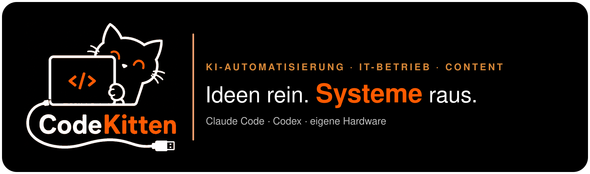

# CodeKitten

**KI-Automatisierung, IT-Betrieb und Content-Systeme**

---

## Kurz über mich

Ich betreibe die gesamte Technik eines kleinen Medienunternehmens: Server, Rechner, Dienste, Backups, KI-Werkzeuge und die Content-Produktion für mehrere Marken. Aus dem Kaufmännischen bringe ich mit, worauf es im Betrieb ankommt: Kosten im Blick behalten, Abläufe verständlich machen und zuverlässig liefern.

Auf dieser Seite steht, was dabei entstanden ist und heute im Alltag läuft.

## Wie ich arbeite

Alle Projekte auf dieser Seite sind mit **Claude Code** und **OpenAI Codex** umgesetzt. Die Anforderungen, die Prüfung der Ergebnisse und den laufenden Betrieb verantworte ich.

Meine Arbeit besteht darin, eine Aufgabe so genau zu beschreiben, dass die KI sie richtig umsetzt, und danach nachzuweisen, dass das Ergebnis wirklich funktioniert. Code lese ich so weit, dass ich Ergebnisse beurteilen und Fehler eingrenzen kann. Dafür gibt es feste Regeln (siehe [Engineering-Standard](#engineering-standard)): Jede Annahme über den Ist-Zustand wird gemessen, und ein Test zählt erst, wenn er bei einem absichtlich eingebauten Fehler auch wirklich anschlägt.

---

## Projekte

### 🎬 Content Creator (CCC)

**Aus jedem Input ein fertiges, geprüftes Reel.** Text, Bild, Video oder eine Sprachaufnahme gehen hinein, ein veröffentlichungsreifes Video kommt heraus. Der Mensch entscheidet an genau einer Stelle, was entstehen soll (Kanal, Gattung, Format, Länge, welche Prüfungen laufen). Danach arbeiten drei Stufen nacheinander:

| Stufe | Was passiert |
|---|---|
| **Skript** | Ein Regelwerk mit 89 Regeln, abgeleitet aus der Analyse von 57 erfolgreichen Videos nach Aufbau, Schnitt, Ton und Humor. Dazu Faktencheck mit Websuche, Verständnis-Prüfung und eine Prüfung auf typische KI-Floskeln. |
| **Produktion** | Stimme, Musik, Bilder, Freisteller, Animation und Schnitt laufen automatisch. Eine Render-Prüfung misst das fertige Video (Format, Länge, Lautheit, sichere Bildbereiche), bevor es weitergeht. |
| **Posting** | Veröffentlichung nach Freigabe, Auswertung der Zahlen nach 1 Stunde, 24 Stunden, 7 und 28 Tagen. |

Das System **lernt aus Feedback**: Rückmeldungen und Ergebnisse werden zu Lektionen, die als Vorschläge zurück in Skript und Produktion fließen. Ein abgewählter Prüfschritt steht sichtbar im Prüfbericht, damit eine Lücke nie wie ein bestandener Test aussieht. Bedient wird alles über eine eigene App mit Regie-Chat, Storyboard, Serien, Bibliothek und Carousel-Editor für drei Marken, auch vom Handy.

**Ergebnis:** Ein beliebiger Input wird ohne Schnittprogramm zum geprüften, veröffentlichten Reel. 
**Stack:** Python, FastAPI, React 19, TypeScript, Vite, Tailwind, pytest, Vitest, Playwright (Desktop- und Handy-Tests), Claude Code im Hintergrundbetrieb, FFmpeg, lokale Stimm- und Audio-Modelle

### 🛰️ Mission Control (ProjectPlanner9000)

**Die Steuerzentrale für Projekte, Rechner und Dienste**, betrieben auf dem eigenen 24/7-Server und täglich in Benutzung.

- **Projekte:** Stand und Verlauf aller Projekte, Dateien mit Namens- und Inhaltssuche, Vorschau für Text, Markdown, Video und Audio
- **Rechner:** Zustand aller Arbeitsrechner und laufende Aufträge über einen kleinen Begleit-Agenten auf jedem Gerät
- **Dienste und Automationen:** Übersicht aller geplanten Läufe und Wächter mit Ampel
- **Grafikkarte:** Lagebild der GPU-Belegung, gespeist vom eigenen VRAM-Verteiler (siehe unten)
- **Sicherheitslage:** Angriffsversuche, offene Ports und ausstehende Updates des Servers, dazu die Server-Dokumentation
- **KI-Kosten:** Verbrauch je Projekt und je Lauf, Grundlage für die Wahl der KI-Dienste
- **Wissen:** Lesezugriff auf die Wissensdatenbank aus allen Arbeitssitzungen

**Ergebnis:** Probleme fallen auf, bevor sie zum Ausfall werden, und Entscheidungen über KI-Dienste beruhen auf echten Kosten. 
**Stack:** Next.js 15, React 19, TypeScript, Prisma, SQLite, Tailwind, WebSocket, Bun, Vitest, systemd

### 🎥 Video- und Content-Produktion

**Automatische Tagesfolgen und Marken-Content für eigene Marken.** Täglich entstehen Folgen, bei denen Themenwahl, Skript, Stimme, Bilder, Schnitt und Qualitätsprüfung bis zur Freigabe ohne Handarbeit laufen. Die Vorschau geht zur Abnahme aufs Handy, veröffentlicht wird erst nach Freigabe.

- **Code-Motion:** Motion-Grafik als Code. Eine HTML-Szene beschreibt jedes Einzelbild, ein Browser rendert es, FFmpeg setzt das Video zusammen. Mit eigener Bibliothek für Typografie, Diagramme, Übergänge, 3D-Räume und Shader-Effekte. Standard für die Good-News-Folgen.
- **Bildprüfung vor dem Versand:** Kein Bild und kein Video verlässt das System, bevor ein Kontaktbogen erzeugt, angesehen und quittiert ist.
- **Carousels und Reels** für Instagram, TikTok und YouTube, geplant und veröffentlicht über Blotato.

**Ergebnis:** Professionelle, einheitliche Videos, viel Output aus wenig Input, kosteneffizient produziert. 
**Stack:** Python, Playwright, HTML/Canvas, WebGL, FFmpeg, Higgsfield, Suno, Blotato

### 🧠 Lokale KI auf eigener Hardware

**Generative KI ohne Cloud, auf eigenen Grafikrechnern im eigenen Netz.** Aufträge werden zentral verteilt, auf dem passenden Rechner gerechnet und danach automatisch geprüft.

| Aufgabe | Modelle |
|---|---|
| Stimme (Sprachausgabe, Stimmumwandlung) | VoxCPM, Qwen TTS, Chatterbox |
| Spracherkennung mit Wort-Zeitstempeln | Whisper |
| Musik und Geräusche | Stable Audio |
| Lippensynchronisation und Mimik | MuseTalk, LivePortrait |
| Figurentausch in echten Videos | Wan (Wan-Animate) |
| Bild- und Videogenerierung auf dem Mac | LTX-2 (MLX), ComfyUI |
| Hochskalieren und Gesichter restaurieren | SeedVR2, GFPGAN |
| Freisteller | BiRefNet |
| Sprachmodelle für Agenten und Werkzeugaufrufe | Ollama mit Gemma 4 und Qwen |

Bei der Modellwahl zählt auch die Lizenz: Für Videos kommen nur Modelle zum Einsatz, deren Lizenz die Nutzung in Deutschland erlaubt.

**Ergebnis:** Stimmen, Musik, Lipsync und Figurentausch für die tägliche Produktion, ohne Cloud-Kosten je Lauf und ohne dass Material das eigene Netz verlässt. 
**Stack:** Python, uv, PyTorch (CUDA und Apple Metal), MLX, ComfyUI, Ollama, PowerShell, SSH

### 🖥️ Rechnerpark und Betrieb

**Ein kleiner, vollständig selbst betriebener Rechnerpark.** Linux-Server als Zentrale, Windows-Grafikrechner mit RTX 4060 Ti, ein Mac mit M4 Max und 64 GB als zweiter KI-Rechner und ein Produktions-Server für die Live-Dienste, alles verbunden über ein privates VPN.

- rund 30 Dienste im Dauerbetrieb, gesteuert über systemd und Docker
- verschlüsselte Backups mit externer Kopie und regelmäßigem Wiederherstellungs-Test
- Wächter für Erreichbarkeit, TLS-Zertifikate, Plattenplatz, Backup-Frische und einen Totmann-Schalter, Alarmierung per Telegram aufs Handy
- Sicherheitsüberwachung mit fail2ban und Lynis
- ein eigener **GPU-Verteiler**: Dienste fragen vor dem Laden eines Modells Grafikspeicher an, ein Wächter erkennt fremde Belegung und zeigt sie in Mission Control

**Ergebnis:** Ausfälle melden sich von selbst, und die Backups werden regelmäßig per Wiederherstellung geprüft. 
**Stack:** Fedora Linux, Windows 11, macOS, Tailscale, SSH, Docker, systemd, Redis, gpg, rclone

### ☁️ Unternehmens-Cloud

**Eine Plattform für das ganze Unternehmen.** Social Media, Vertrieb, Kundenbetreuung, Werbung, Marketing und Compliance laufen in einer Oberfläche mit Rollen für Admin, Team und Freelancer. Kunden bekommen ein eigenes Portal mit Projektstand, nächsten Schritten, offenen Punkten und Dokumenten. Jeder sieht nur seine eigenen Daten. Das ist direkt in der Datenbank abgesichert und mit Prüfskripten belegt, die bei einer absichtlich eingebauten Lücke nachweislich anschlagen.

**Ergebnis:** Eine zentrale Anlaufstelle statt vieler einzelner Programme, für das Team und für Kunden. 
**Stack:** React 19, TypeScript, Vite, Tailwind, Supabase (selbst betrieben), PostgreSQL mit Row Level Security, Deno Edge Functions, Docker Compose, GitHub Actions

### 🔁 Delegations-Workflow

**Eine KI plant und prüft, eine zweite setzt um.** Das starke Modell schreibt einen genauen Plan und kontrolliert am Ende das Ergebnis, ein günstigerer Agent (Hermes mit Codex) erledigt die Umsetzung. Gemessen über **188 Aufgaben in 29 Läufen**, mit rund 5 Millionen ausgelagerten Umsetzungs-Tokens, offen dokumentiert:

➡️ **[claude-codex-delegation](https://github.com/Cha0smast3r110/claude-codex-delegation)**

**Ergebnis:** Teure KI-Kapazität geht in Planung und Prüfung, die Fleißarbeit erledigt ein günstigerer Agent. 
**Stack:** Claude Code, Codex, Hermes

### 📐 Engineering-Standard

**Verbindliche Regeln für jedes Projekt**, entstanden aus einer Auswertung der eigenen Fehler. Ein Ein-Personen-Betrieb mit KI hat kein Team, das gegenliest, deshalb sind die Kontrollen fest eingebaut:

- vier Realitäts-Regeln: Ist-Zustand messen statt erinnern, ungemessene Annahmen kennzeichnen, jeder Test braucht eine Gegenprobe, vor jeder Änderung bestehende Prüfungen auf Widerspruch prüfen
- ein Ablauf vom Ziel bis zum fertigen Produkt in elf Schritten mit sechs Prüftoren
- eine Definition of Done, die in jeden Plan kommt, damit niemand „fertig“ meldet, nur weil der Normalfall funktioniert
- ein Prüf-Agent, der Projekte gegen den Standard auditiert, und Hooks, die die Regeln bei jeder Aufgabe einblenden

**Ergebnis:** Jede Aussage über den Zustand eines Systems ist belegt, bevor darauf aufgebaut wird.

### 📚 Cha0sBrain

**Wissensdatenbank aus allen Arbeitssitzungen.** Nach jeder KI-Arbeitssitzung entstehen automatisch strukturierte, durchsuchbare Notizen: Anleitungen, Fehlerbehebungen und Erkenntnisse, über alle Rechner hinweg.

➡️ **[Cha0sBrain](https://github.com/Cha0smast3r110/Cha0sBrain)** (Open Source)

**Stack:** Python, Obsidian, Claude Code Hooks, pytest

---

## Werkzeuge und Technik

| Bereich | |
|---|---|
| **KI-Agenten** |    |
| **Lokale KI** |       |
| **Generative Medien** |    |
| **Daten und Web** |      |
| **Browser-Automatisierung** |    |
| **Betrieb** |      |
| **Entwicklung** |   |
| **Content** |    |

---

## Warum der Code privat ist

Der Code von CCC, Mission Control, der Unternehmens-Cloud und der Produktions-Pipeline bleibt privat, weil er Kundendaten und interne Abläufe berührt. Öffentlich einsehbar sind [claude-codex-delegation](https://github.com/Cha0smast3r110/claude-codex-delegation) und [Cha0sBrain](https://github.com/Cha0smast3r110/Cha0sBrain). Die Ergebnisse der Content-Produktion laufen auf [Instagram @codekitten.ai](https://instagram.com/codekitten.ai).
